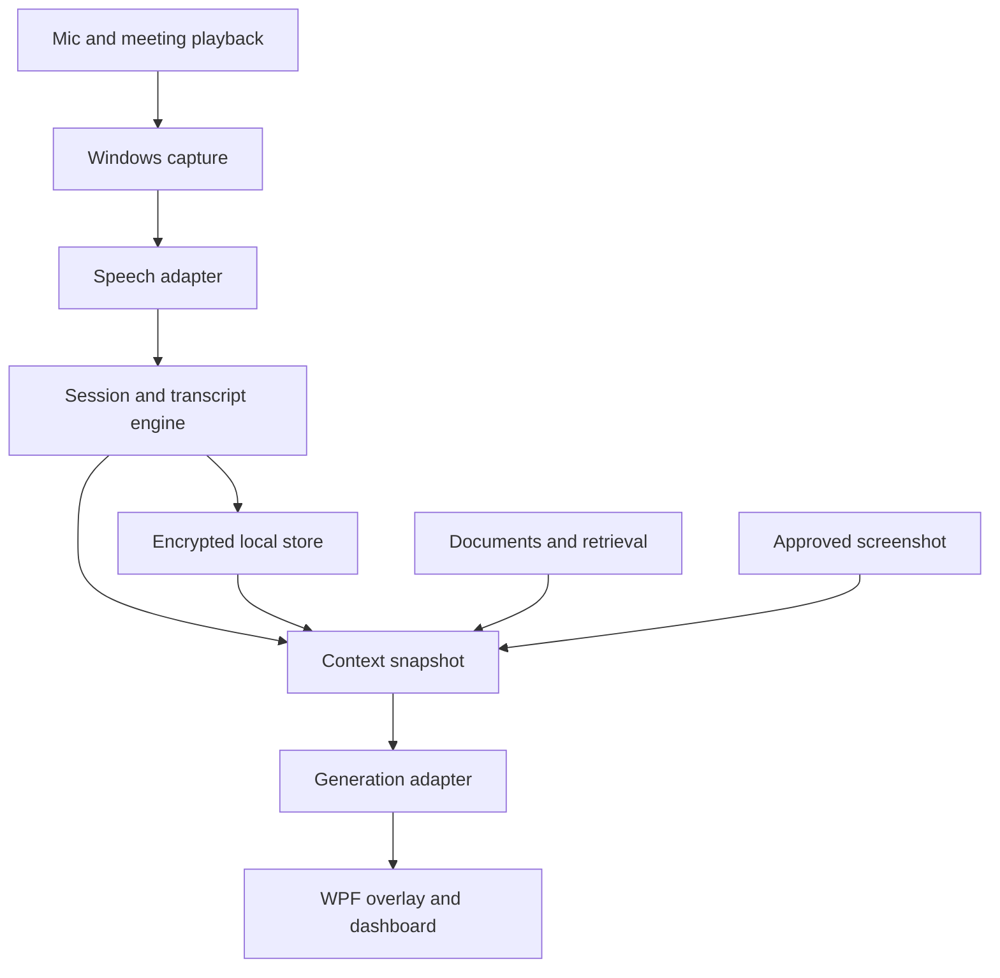

# Sidecue technical baseline

Version 0.1. Adopted as the implementation planning baseline on November 6, 2026. No implementation or runtime behavior has yet been validated. Read [DECISIONS.md](DECISIONS.md) for decisions and unresolved implementation selections; read [Architecture_v0.1.txt](../source/Architecture_v0.1.txt) for the full rationale and source research.

## Shape

Build an original Windows 11 x64 desktop application in C#/.NET 10 with WPF, XAML, and CommunityToolkit.Mvvm. Use one application process, explicit asynchronous orchestration, bounded background workers, encrypted local persistence, and provider adapters. Optional native inference or document-conversion workers can be isolated later. The baseline does not require administrator rights, a local web server, a Windows service, or a dedicated inference GPU.

Audio capture and retained history are local. Initial speech, generation, and embeddings use cloud services with user-configured keys. The application must accurately show these boundaries. A Sidecue account/backend is not a prerequisite for the personal release.

Speech and generation adapters cross the configured provider boundary. The transcript/store and context assembler are separate responsibilities.

## Projects and dependencies

| Project | Dependencies allowed | Responsibilities |
| --- | --- | --- |
| Sidecue.Core | BCL and minimal domain dependencies | Immutable records, IDs, timing, evidence, state definitions |
| Sidecue.Application | Core | Use cases, session/retrieval/assistance orchestration, provider/store interfaces |
| Sidecue.Windows | Application, Core, Windows libraries | WASAPI, window affinity, screenshots, endpoint changes, hotkeys, monitors |
| Sidecue.Infrastructure | Application, Core, provider/storage libraries | SQLCipher, providers, retrieval, imports, jobs, exports, protected credentials |
| Sidecue.Desktop | All above at composition root | WPF views/view models, tray, settings, overlay, dependency registration |

Core and Application must not reference WPF, Windows capture, database, or provider SDK types. Implementations must not depend on Desktop. Views use application services and view models; a view must not call a cloud SDK or write SQL. Windows and Infrastructure need not reference each other; compose shared interfaces from Desktop.

Target Core/Application so their pure tests can run without a Windows desktop where practical. Windows/Desktop projects use appropriate Windows target frameworks. Pin exact SDK, runtime target, NuGet versions, and build-image selection during bootstrap. Verify the real installed/native versions rather than guessing pins from this package's creation date.

## External dependencies

| Concern | Decision |
| --- | --- |
| Audio | WASAPI shared microphone and render loopback; stable NAudio where suitable; narrow custom COM bindings where required |
| App audio isolation | Windows process-tree loopback with labelled system-audio fallback |
| Screen | Windows.Graphics.Capture with native target selection and preview |
| Overlay exclusion | SetWindowDisplayAffinity using WDA_EXCLUDEFROMCAPTURE, verified per capture scenario |
| STT | Deepgram streaming WebSocket, independent mic/remote connections |
| Generation | OpenAI adapter first, configurable live/detailed model slots; Anthropic later |
| Embeddings | text-embedding-3-small initially, model/dimension/extraction generation recorded |
| Retrieval | SQLite FTS5 plus exact embedding cosine search and reciprocal rank fusion |
| Storage | Microsoft.Data.Sqlite.Core with validated SQLCipher native distribution |
| Keys | Current-user DPAPI, user ACLs |
| Runtime | Generic Host, DI, logging, Channels, async streams, cancellation |
| Packaging | Self-contained win-x64, Velopack, signed release channel |
| Tests | xUnit, deterministic replays, Windows UI Automation/FlaUI where appropriate |

Select exact provider model IDs by replay evaluation. Cap requests using actual model capabilities. Test that encrypted SQLite includes FTS5, encrypted journals, and the relevant upstream durability fixes. A NuGet name or password property is insufficient proof. Do not silently fall back to plaintext storage.

## Runtime rules

Preserve source/timeline metadata before normalization. Capture callbacks enqueue only bounded work. Network and persistence cannot back-pressure the native callback indefinitely. Known lost intervals become gap events.

The session controller owns lifecycle. A transcript reconciler owns revisions and committed final segments. A request coordinator freezes context, applies priorities, cancels superseded work, and rejects stale output. The UI renders events and commands without owning those rules.

An answer uses recent transcript, source-linked summary, retrieved evidence, selected profile, and optional approved image. It does not repeatedly upload the entire saved meeting. The initial context/output budgets and queue sizes in the source architecture are tuning defaults, not verified performance or provider limits.

SQLite has one serialized writer. Keep user data in `%LocalAppData%/SidecueData`, outside Velopack's RootAppDir. Normalized model context, final transcript storage, and user-edited artifacts must not share a mutable scratch record.

## Initial UX boundaries

The dashboard contains diagnostics, settings, history, and editable notes. The overlay contains compact responses, evidence access, capture status, pause/end controls, and keyboard actions. Non-activating display and interactive input are distinct states. Multi-monitor and DPI behavior must use real target identity rather than matching screen sizes.

Start with manual assistance. Automatic chips, coding profiles, and other modes reuse the same request coordinator after manual quality is established. Follow-ups are drafts. The runtime does not autonomously click other applications, execute generated code, or send messages.

## Later extension points

Local inference uses the same provider interfaces with explicit capability reporting and resource supervision. Hosted integration uses a modular ASP.NET Core service, PostgreSQL/pgvector, object storage, and durable jobs. Calendar webhooks need a reachable backend; a desktop-only integration begins with appropriate incremental synchronization. Team authorization must precede shared search/sync. These are future boundaries, not tasks to implement during the Windows proof phase.
